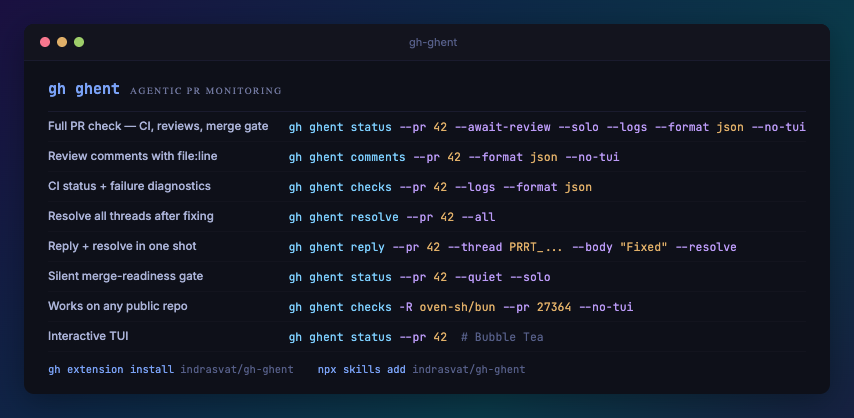

<p align="center">
  
  <br><br>
  <strong>Agentic PR monitoring for GitHub</strong>
  <br>
  <em>Interactive TUI for humans, structured output for AI agents</em>
  <br><br>
  <a href="https://gh-ghent.pages.dev"><strong>gh-ghent.pages.dev</strong></a>
  <br><br>
  <a href="#install">Install</a> · <a href="#quick-start">Quick Start</a> · <a href="#how-it-works">How It Works</a> · <a href="#cloud-sessions-and-ci">Cloud Sessions</a> · <a href="#commands">Commands</a> · <a href="#global-flags">Global Flags</a> · <a href="#agent-integration">Agent Integration</a> · <a href="#for-ai-agents-agent-skill">Agent Skill</a> · <a href="#development">Development</a>
</p>

## Install

Requires [GitHub CLI](https://cli.github.com/) (`gh`) v2.0+.

```bash
gh extension install indrasvat/gh-ghent
```

No `gh`? (cloud sessions, CI, containers) Install the prebuilt binary and run
it as `gh-ghent` — see [Cloud Sessions and CI](#cloud-sessions-and-ci).

## Quick Start

```bash
# See unresolved review threads
gh ghent comments --pr 42

# Check CI status
gh ghent checks --pr 42

# Full PR dashboard with merge readiness
gh ghent status --pr 42

# A PR in another repo — no checkout needed
gh ghent status -R oven-sh/bun --pr 42 --format json --no-tui
```

## How It Works

ghent detects your environment automatically:

- **TTY** (interactive terminal) — launches a Bubble Tea TUI with keyboard navigation, tabs, and expandable views
- **Piped / `--no-tui`** — outputs structured data (JSON by default) for scripts and AI agents

No configuration needed. The token comes from `GH_TOKEN` / `GITHUB_TOKEN`, or
from `gh auth` when those are unset.

A token is required even for public repos: review threads come from GitHub's
GraphQL API, which rejects anonymous requests.

## Cloud Sessions and CI

ghent runs without `gh` and without a terminal. In a fresh cloud VM:

```bash
# 1. Prebuilt binary (linux/darwin, amd64/arm64, checksum-verified) into ~/.local/bin
curl -fsSL https://raw.githubusercontent.com/indrasvat/gh-ghent/main/install.sh | bash

# 2. A token. GH_TOKEN or GITHUB_TOKEN; no `gh auth login` needed.
export GH_TOKEN=...

# 3. If your token comes from a vault or egress proxy that swaps the real token
#    in only on `Authorization: Bearer` requests, switch the auth scheme:
export GH_GHENT_AUTH_SCHEME=bearer   # default: token (what gh sends)

# 4. From the repo checkout, on the PR branch — ghent finds the PR itself:
gh-ghent status --await-review --solo --logs --format json --no-tui
```

`--pr` takes a number, a branch name, or `OWNER:BRANCH` for a PR opened from a
fork. Without `--pr`, ghent looks up the open PR whose head is the current
branch in the target repo. It never guesses: no match or more than one match is
an error that says what to pass instead.

**Least-privilege tokens.** Fine-grained tokens have no Checks permission to
grant, so on private repos GitHub denies check runs (403). ghent then rebuilds
the checks from GitHub Actions jobs and commit statuses (needs `actions: read`
and `commit statuses: read`) and says so in a `fallback` field. Check runs from
other apps (not Actions) and annotations are not visible that way, so
`is_merge_ready` stays `false` while the fallback is in use; job logs still
work.

**Errors say which problem you hit** (all exit `2`): no token found; token
rejected (401, with the Bearer hint); or token valid but missing a permission
(403, with GitHub's message).

## Commands

### `gh ghent comments`

Show unresolved review threads for a PR.

```bash
gh ghent comments --pr 42                    # Interactive TUI
gh ghent comments --pr 42 --format json      # JSON for agents
gh ghent comments --pr 42 --format json | jq '.unresolved_count'
```

| Flag | Description |
|------|-------------|
| `--pr` | PR number, `BRANCH`, or `OWNER:BRANCH` (default: the open PR for the current branch) |

Exit codes: `0` = no unresolved threads, `1` = has unresolved threads.

### `gh ghent checks`

Show CI check runs, status, and annotations.

```bash
gh ghent checks --pr 42                      # Interactive TUI
gh ghent checks --pr 42 --logs               # Include error logs
gh ghent checks --pr 42 --watch              # Poll until complete
gh ghent checks --pr 42 --format json | jq '.overall_status'
```

| Flag | Description |
|------|-------------|
| `--pr` | PR number, `BRANCH`, or `OWNER:BRANCH` (default: the open PR for the current branch) |
| `--logs` | Include failing job log excerpts in output |
| `--watch` | Poll until all checks complete, fail-fast on failure |

Exit codes: `0` = all pass, `1` = failure, `3` = pending.

### `gh ghent resolve`

Resolve or unresolve review threads.

```bash
gh ghent resolve --pr 42 --thread PRRT_abc123        # Single thread
gh ghent resolve --pr 42 --all                        # All threads
gh ghent resolve --pr 42 --thread PRRT_abc123 --unresolve  # Reopen
```

| Flag | Description |
|------|-------------|
| `--pr` | PR number, `BRANCH`, or `OWNER:BRANCH` (default: the open PR for the current branch) |
| `--thread` | Thread ID to resolve (PRRT_... node ID) |
| `--all` | Resolve all unresolved threads |
| `--unresolve` | Unresolve instead of resolve |

Exit codes: `0` = all success / no-op success, `1` = partial failure, `2` = total failure.

### `gh ghent reply`

Reply to a review thread. Designed for AI agent use.

```bash
gh ghent reply --pr 42 --thread PRRT_abc123 --body "Fixed in latest commit"
gh ghent reply --pr 42 --thread PRRT_abc123 --body-file response.md
echo "Acknowledged" | gh ghent reply --pr 42 --thread PRRT_abc123 --body-file -
```

| Flag | Description |
|------|-------------|
| `--pr` | PR number, `BRANCH`, or `OWNER:BRANCH` (default: the open PR for the current branch) |
| `--thread` | Thread ID to reply to (required) |
| `--body` | Reply body text (supports markdown) |
| `--body-file` | Read reply body from file (`-` for stdin) |

Exit codes: `0` = reply posted, `1` = thread not found, `2` = error.

### `gh ghent dismiss`

Dismiss stale blocking reviews that are no longer about the current PR head.

```bash
gh ghent dismiss --pr 42 --dry-run
gh ghent dismiss --pr 42 --bots-only --message "superseded by current HEAD"
gh ghent dismiss --pr 42 --review PRR_kwDO... --message "superseded by current HEAD"
```

This command is intentionally narrow:

- only `CHANGES_REQUESTED` reviews
- only when the review commit is stale relative to the current PR head
- never current reviews

| Flag | Description |
|------|-------------|
| `--pr` | PR number, `BRANCH`, or `OWNER:BRANCH` (default: the open PR for the current branch) |
| `--review` | Review node ID or numeric review ID to dismiss |
| `--author` | Limit to one review author |
| `--bots-only` | Limit to stale blocking bot reviews |
| `--message` | Dismissal message sent to GitHub (required unless `--dry-run`) |
| `--dry-run` | Preview matching stale blockers without dismissing |

Exit codes: `0` = all success, `1` = partial failure, `2` = total failure.

### `gh ghent status`

Combined PR status dashboard with merge-readiness assessment.

```bash
gh ghent status --pr 42                     # Interactive dashboard
gh ghent status --pr 42 --logs --format json  # Full status with failure diagnostics
gh ghent status --pr 42 --watch --format json # Wait for CI, then full report
gh ghent status --pr 42 --await-review        # Wait for CI + bounded review stabilization
gh ghent status --pr 42 --quiet               # Silent merge-readiness gate
gh ghent status --pr 42 --solo                # Skip approval check (personal repos)
gh ghent status --pr 42 --format json | jq '.stale_reviews'
```

| Flag | Description |
|------|-------------|
| `--pr` | PR number, `BRANCH`, or `OWNER:BRANCH` (default: the open PR for the current branch) |
| `--logs` | Include failing job log excerpts and annotations |
| `--watch` | Poll until CI completes, then output full status |
| `--await-review` | After CI completes, wait for bounded review stabilization (implies `--watch`) |
| `--review-timeout` | Hard timeout for `--await-review` (default: `5m`) |
| `--quiet` | Silent on merge-ready (exit 0), full output on not-ready (exit 1) |
| `--compact` | One-line-per-thread compact digest for agents |
| `--solo` | Skip approval requirement for single-maintainer repos |

Merge-ready when: no unresolved threads + all checks pass + at least one approval.
With `--solo`, the approval requirement is skipped (but `CHANGES_REQUESTED` still blocks).
Stale `CHANGES_REQUESTED` reviews still block until explicitly dismissed. `status` surfaces them in
`stale_reviews` and suggests a safe `gh ghent dismiss` command.

`--await-review` watches Codex-owned PR-level review signals as well as threads and reviews.
On repos with Codex enabled, an `eyes` marker keeps the review wait open; a Codex-owned
`thumbs up` completion marker can end the wait early, after which `status` still performs
the normal full threads/checks/reviews fetch. Repos without Codex keep the conservative
thread/review polling behavior.

Exit codes: `0` = merge-ready, `1` = not merge-ready.

## Global Flags

These flags work with all commands:

| Flag | Short | Description | Default |
|------|-------|-------------|---------|
| `--repo` | `-R` | Repository in OWNER/REPO format (flag beats `GH_REPO`, which beats the git remote) | current repo (`GH_REPO` if set) |
| `--format` | `-f` | Output format: `json`, `md`, `xml` | `json` |
| `--no-tui` | | Force pipe mode even in TTY | `false` |
| `--verbose` | | Show additional context | `false` |
| `--debug` | | Debug logging to stderr | `false` |
| `--solo` | | Skip approval requirement (`GH_GHENT_SOLO=1`) | `false` |
| `--pr` | | PR number, `BRANCH`, or `OWNER:BRANCH` for a PR from a fork | open PR for the current branch |

Set `GH_REPO=owner/repo` to target one repo for a whole session without
passing `-R` every time. (`GH_GHENT_REPO` is unrelated: it overrides the
release repo in `install.sh`.)

## Agent Integration

ghent is built for AI coding agents. Use `--no-tui --format json` for reliable structured output.

### JSON Output

```bash
# Get unresolved threads with IDs for resolution
gh ghent comments --pr 42 --format json --no-tui

# Check CI and get failure details
gh ghent checks --pr 42 --format json --logs --no-tui

# One-shot merge readiness
gh ghent status --pr 42 --format json --no-tui | jq '.is_merge_ready'

# Surface stale blocking reviews
gh ghent status --pr 42 --format json --no-tui | jq '.stale_reviews'
```

### Exit Codes

All commands use meaningful exit codes for scripting:

| Code | Meaning |
|------|---------|
| `0` | Success / pass / merge-ready |
| `1` | Action needed (unresolved threads, check failure, not merge-ready) |
| `2` | Error (API failure, auth, permissions) |
| `3` | Pending (checks still running) |

For `dismiss`, exit `0` also covers the safe no-op case where no stale blockers matched. Exit `1` means partial dismissal failure and exit `2` means every attempted dismissal failed.

### Agent Workflow Example

```bash
# 1. Use the single blessed review command
STATUS=$(gh ghent status --pr 42 --await-review --logs --format json --no-tui)

# 2. Fix CI failures if present
echo "$STATUS" | jq '.checks.checks[] | select(.conclusion=="failure") | {name, log_excerpt, annotations}'

# 3. Read unresolved review threads
echo "$STATUS" | jq '.comments.threads[] | {id, path, line, body: .comments[0].body}'

# 4. Fix code, then resolve + reply as needed
gh ghent resolve --pr 42 --all --format json

# 5. After pushing fixes, run the same command again
STATUS=$(gh ghent status --pr 42 --await-review --logs --format json --no-tui)

# 6. If stale blockers exist, dismiss only those stale blockers
echo "$STATUS" | jq '.stale_reviews'
gh ghent dismiss --pr 42 --bots-only --message "superseded by current HEAD"

# 7. Stop only when merge-ready and review_monitor is not low-confidence
echo "$STATUS" | jq '{merge_ready: .is_merge_ready, stale_reviews: .stale_reviews, review_monitor: .review_monitor}'
```

### Output Formats

**JSON** (default) — machine-readable, works with `jq`:
```bash
gh ghent checks --pr 42 --format json
```

**Markdown** — human-readable piped output:
```bash
gh ghent comments --pr 42 --format md
```

**XML** — structured markup:
```bash
gh ghent checks --pr 42 --format xml
```

## For AI Agents (Agent Skill)

ghent ships an [Agent Skill](https://agentskills.io) so AI coding agents (Claude Code, Codex, Cursor, Cline, Copilot, Amp, etc.) can discover and use it automatically.

```bash
npx skills add indrasvat/gh-ghent
```

The skill teaches agents when and how to use ghent — triggering conditions, pipe-mode commands, JSON output parsing, exit code branching, and complete review-fix-resolve workflows. See [`skill/SKILL.md`](skill/SKILL.md) for the full skill content.

## Development

```bash
make build     # Build binary
make test      # Run tests
make lint      # Run linter
make ci        # Full CI check (lint + test + vet)
make install   # Build and register as gh extension
```

## License

MIT
